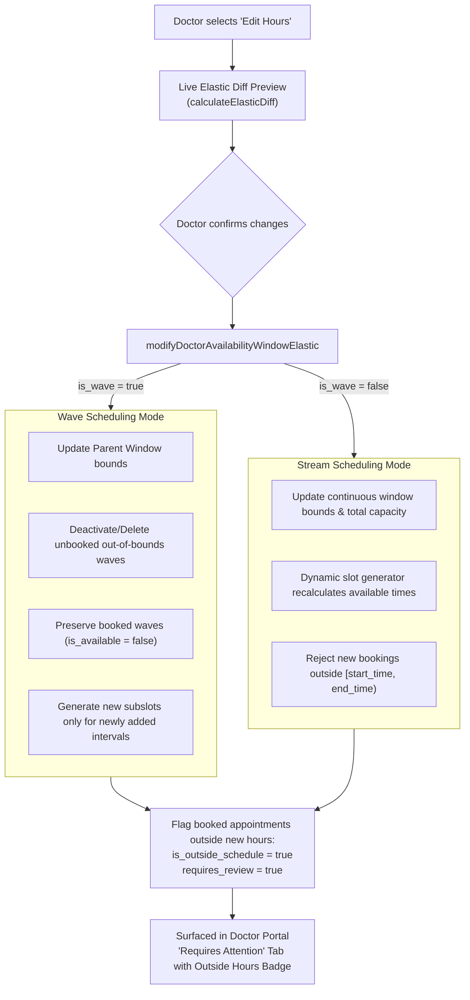

# Medrella – Elastic Scheduling Implementation Report

## Executive Summary

**Elastic Scheduling** enables healthcare practitioners in Medrella to dynamically adapt their clinical working hours—expanding or shrinking availability windows across **Wave** and **Stream** scheduling modes—without losing or disrupting previously booked patient consultations.

### The Problem Solved

Prior to Elastic Scheduling, updating availability windows required either completely replacing an existing window via `is_override = true` or deleting and recreating slots. While `is_override = true` safely retained booked slots, any unbooked time slots outside the new window were dropped, and appointments remaining in the previous hours had no structural indicator that the doctor's published hours had changed. Furthermore, there was no granular mechanism to:
1. Preview the exact delta of added vs. removed slots before saving.
2. Distinguish active consultation hours from legacy booked appointments that fell outside updated clinical hours.
3. Elastically stretch or compress continuous Stream scheduling windows without risking overbooking or booking outside the new working hours.

### The Solution

The Elastic Scheduling engine introduces deterministic delta calculation, soft deactivation of out-of-schedule booked slots, atomic parent-child window reconciliation, and automatic review flagging:



---

## 1. Architectural Design & Core Capabilities

### 1.1 Schedule Shrinking
- **Time Window Compression**: Modifying a window (e.g., `10:00 AM – 12:00 PM` $\rightarrow$ `10:00 AM – 11:00 AM`) updates the parent availability window to the new bounds.
- **Unbooked Slot Removal**: Subslots in the removed interval (`11:00 – 12:00`) that have 0 patient bookings are permanently purged from the database, preventing clutter and ensuring patients cannot see or book them.
- **Booked Slot Preservation**: Any subslot in the removed interval containing confirmed patient appointments is **strictly preserved** in the database to maintain referential integrity. Its status is set to `is_available = false` to guarantee no further patients can be scheduled.
- **Conflict Flagging**: Any active appointments within the shrunk interval are automatically updated:
  - `is_outside_schedule: true`
  - `requires_review: true`
  - `review_reason: "Booked outside updated working hours (10:00 - 11:00)"`

### 1.2 Schedule Expansion
- **Time Window Extension**: Modifying a window (e.g., `10:00 AM – 12:00 PM` $\rightarrow$ `09:00 AM – 12:00 PM`) widens the window bounds.
- **Non-Duplicative Generation**: Only subslots in the newly added interval (`09:00 – 10:00`) are instantiated. Existing slots in `10:00 – 12:00` (and their existing patient bookings) remain untouched without duplicates.
- **Automatic Unflagging**: If the doctor re-expands a schedule to encompass an appointment that was previously flagged as outside working hours, the engine automatically clears `is_outside_schedule = false`, `requires_review = false`, and `review_reason = null`.

### 1.3 Wave vs. Stream Compatibility

| Dimension | Wave Scheduling | Stream Scheduling |
| :--- | :--- | :--- |
| **Data Structure** | 1 Parent availability record + $N$ child subslots referencing `parent_availability_id`. | 1 Continuous availability record representing the operating session. |
| **Expansion** | Inserts child subslots only for newly added intervals under the existing parent window. | Updates `start_time`, `end_time`, and recomputes total capacity; dynamic slots are rendered at request time. |
| **Shrinking** | Deletes unbooked subslots; marks booked subslots outside hours as `is_available = false`. | Updates continuous window bounds; booking engine strictly blocks requests outside `[start_time, end_time)`. |
| **Outside Appointment Retention** | Booked child subslot preserved in database; appointment linked directly. | Continuous window updated; appointment remains linked to window with `is_outside_schedule = true`. |

### 1.4 Recurring & Non-Recurring Support
- **Recurring Weekly**: Propagates elastic adjustments across matching future weekdays within the specified date range. Historical/past dates are strictly preserved and never mutated.
- **Specific Dates**: Targets only the selected date while leaving all other days untouched.
- **Date-Specific Overrides**: Standalone custom windows and date-specific blocked days remain intact.

### 1.5 Transaction & Concurrency Safety
- **State Snapshot Rollback**: In-memory and database operations take a pre-modification snapshot. Any unexpected error triggers a complete rollback to prevent partial or corrupted availability states.
- **Expansion Collision Guard**: Before expanding a window, the engine checks for overlapping independent availability windows or blocked days on that date and rejects colliding modifications with a descriptive validation error.
- **Atomic Booking Protection**: `bookAppointmentAtomic` validates that dynamic or wave requested times fall strictly within the active window boundaries, rejecting removed or deactivated slots immediately.

---

## 2. Modified and Created Files

### 2.1 Database & Migrations
- [`src/types/database.ts`](file:///c:/Users/Siddhesh/Desktop/PearlThought/pearl-thoughts-schedule-project/src/types/database.ts): Extended `Appointment` interface with `is_outside_schedule?: boolean; requires_review?: boolean; review_reason?: string | null;`.
- [`src/lib/db/schema.ts`](file:///c:/Users/Siddhesh/Desktop/PearlThought/pearl-thoughts-schedule-project/src/lib/db/schema.ts): Added `is_outside_schedule`, `requires_review`, and `review_reason` columns to Drizzle `appointments` schema.
- [`scripts/migrate-elastic-scheduling.ts`](file:///c:/Users/Siddhesh/Desktop/PearlThought/pearl-thoughts-schedule-project/scripts/migrate-elastic-scheduling.ts): Executed DDL migration on live Neon PostgreSQL database adding columns idempotently.

### 2.2 Scheduling Engine & Slot Generator
- [`src/lib/scheduling/slot-generator.ts`](file:///c:/Users/Siddhesh/Desktop/PearlThought/pearl-thoughts-schedule-project/src/lib/scheduling/slot-generator.ts):
  - Implemented `calculateElasticDiff(oldStartTime, oldEndTime, newStartTime, newEndTime, slotDuration): ElasticDiffResult`.
  - Deterministically computes `addedSlots`, `removedSlots`, `preservedSlots`, `isShrinking`, `isExpanding`, and `isShift`.

### 2.3 Universal Database Layer
- [`src/lib/db/local-store.ts`](file:///c:/Users/Siddhesh/Desktop/PearlThought/pearl-thoughts-schedule-project/src/lib/db/local-store.ts) & [`src/lib/db/index.ts`](file:///c:/Users/Siddhesh/Desktop/PearlThought/pearl-thoughts-schedule-project/src/lib/db/index.ts):
  - `modifyDoctorAvailabilityWindowElastic`: Modifies a single window (Wave or Stream) elastically with rollback protection, unbooked slot pruning, booked slot preservation, and appointment review flagging.
  - `modifyDoctorScheduleElastic`: Batch elastic modification across recurring or specific dates.
  - `previewDoctorScheduleElasticChanges`: Read-only diff generator calculating added/removed slots and conflicting booked appointments.
  - `getAppointmentsRequiringReview`: Returns all active appointments flagged with `requires_review` or `is_outside_schedule`.
  - `bookAppointmentAtomic`: Added strict boundary validation preventing booking outside updated stream window hours.

### 2.4 Server Actions & Validations
- [`src/lib/validations/schemas.ts`](file:///c:/Users/Siddhesh/Desktop/PearlThought/pearl-thoughts-schedule-project/src/lib/validations/schemas.ts):
  - `modifyDoctorAvailabilityWindowElasticSchema`
  - `modifyDoctorScheduleElasticSchema`
  - `previewDoctorScheduleElasticSchema`
- [`src/app/actions/doctor.actions.ts`](file:///c:/Users/Siddhesh/Desktop/PearlThought/pearl-thoughts-schedule-project/src/app/actions/doctor.actions.ts):
  - `modifyDoctorAvailabilityWindowElasticAction`
  - `modifyDoctorScheduleElasticAction`
  - `previewDoctorScheduleElasticAction`
  - `getAppointmentsRequiringReviewAction`

### 2.5 User Interface Components
- [`src/components/doctor/DoctorAvailabilityManager.tsx`](file:///c:/Users/Siddhesh/Desktop/PearlThought/pearl-thoughts-schedule-project/src/components/doctor/DoctorAvailabilityManager.tsx):
  - Added "Edit Hours" button (`Sliders` icon) on availability cards.
  - Added interactive Elastic Schedule Window Modification Modal.
  - Live preview calculating `+ Added` and `- Removed` slots in real time.
  - Conflict warning banner showing affected patient appointments.
- [`src/components/doctor/DoctorAppointmentsTable.tsx`](file:///c:/Users/Siddhesh/Desktop/PearlThought/pearl-thoughts-schedule-project/src/components/doctor/DoctorAppointmentsTable.tsx):
  - Added "Requires Attention" tab filter with badge counter.
  - Added "Outside Hours" badge on flagged appointment rows.
  - Added top alert notification banner when appointments require review.

---

## 3. Automated Verification & Test Results

### 3.1 Elastic Scheduling QA Suite (`scripts/test-elastic-scheduling.ts`)
Tested all 14 mandatory scenarios with 100% pass rate:

```text
================================================================================
MEDRELLA ELASTIC SCHEDULING QA SUITE (14 SCENARIOS)
================================================================================

Scenario 1: Shrinking 10 AM–12 PM to 10 AM–11 AM (No Bookings)
  ✓ [PASS] Initial 10:00–12:00 stream window created
  ✓ [PASS] Updated window start time is 10:00
  ✓ [PASS] Updated window end time is 11:00
  ✓ [PASS] Removed 2 unbooked slots (11:00-11:30, 11:30-12:00)
  ✓ [PASS] Zero slots added during pure shrink
  ✓ [PASS] Patient portal dynamically receives exactly 2 slots (10:00 and 10:30)
  ✓ [PASS] Slots span 10:00 to 11:00 only

Scenario 2: Expanding 10 AM–12 PM to 9 AM–12 PM (No Bookings)
  ✓ [PASS] Expanded window start time is 09:00
  ✓ [PASS] Expanded window end time is 12:00
  ✓ [PASS] Added 2 newly expanded slots (09:00-09:30, 09:30-10:00)
  ✓ [PASS] Zero slots removed during expansion
  ✓ [PASS] Patient portal dynamically receives 6 slots spanning 09:00 to 12:00
  ✓ [PASS] First available slot is 09:00
  ✓ [PASS] Last available slot starts at 11:30

Scenario 3: Shrinking a Schedule Containing Existing Booked Appointments
  ✓ [PASS] Initial wave schedule has 4 subslots
  ✓ [PASS] Inside appointment booked at 10:00
  ✓ [PASS] Outside appointment booked at 11:00
  ✓ [PASS] Exactly 1 appointment flagged outside new window
  ✓ [PASS] Flagged appointment matches appOutside
  ✓ [PASS] Subslot 11:00 with booking was strictly preserved in database
  ✓ [PASS] Preserved 11:00 subslot marked is_available = false
  ✓ [PASS] Unbooked 11:30 subslot was cleanly removed from database

Scenario 4: Expanding Without Duplicating Existing Slots
  ✓ [PASS] Generated exactly 2 new subslots (09:00-09:30, 09:30-10:00)
  ✓ [PASS] Preserved the 2 existing subslots in 10:00-11:00
  ✓ [PASS] Active subslots within new window is 4 (09:00, 09:30, 10:00, 10:30)
  ✓ [PASS] All 4 active subslots have unique start times with 0 duplicates
  ✓ [PASS] Total subslots is 5: 4 active within window + 1 preserved inactive for outside booking

Scenario 5: Preserving Appointments Outside the Updated Window
  ✓ [PASS] Outside appointment still exists with unchanged primary key
  ✓ [PASS] Outside appointment was NOT cancelled
  ✓ [PASS] is_outside_schedule flag is true
  ✓ [PASS] requires_review flag is true
  ✓ [PASS] review_reason specifies reason for doctor attention
  ✓ [PASS] getAppointmentsRequiringReview includes the flagged appointment

Scenario 6: Preserving Patient and Payment Information
  ✓ [PASS] Patient ID strictly preserved
  ✓ [PASS] Patient name and profile accessible
  ✓ [PASS] Payment record linked and preserved
  ✓ [PASS] Payment amount of ₹750 intact

Scenario 7: Wave Scheduling Expansion and Shrinking
  ✓ [PASS] Window shrunk on both boundaries
  ✓ [PASS] Removed unbooked 10:00 and 11:30 slots
  ✓ [PASS] Preserved 10:30 and 11:00 slots
  ✓ [PASS] Re-added 10:00 and 11:30 slots on expansion
  ✓ [PASS] Preserved 10:30 and 11:00 slots without duplication

Scenario 8: Stream Scheduling Expansion and Shrinking
  ✓ [PASS] Stream outside appointment flagged for review
  ✓ [PASS] Flagged appointment matches 15:30 consult
  ✓ [PASS] Only 1 available slot remaining in 14:00 - 15:00 (14:30)
  ✓ [PASS] 14:30 is available for new patient booking
  ✓ [PASS] Appointment unflagged after expanding window back to cover it

Scenario 9: Recurring Schedule Modifications
  ✓ [PASS] Created recurring Tuesday windows across date range
  ✓ [PASS] Recurring schedule elastic modification succeeded
  ✓ [PASS] All matching recurring dates modified
  ✓ [PASS] All recurring windows successfully updated to 09:00–11:00

Scenario 10: Non-Recurring Schedule Modifications
  ✓ [PASS] Modified exactly 1 specific date
  ✓ [PASS] Target date window end time shrunk to 11:30

Scenario 11: Preserving Date-Specific Overrides
  ✓ [PASS] Date-specific override window exists at 15:00–17:00
  ✓ [PASS] Date-specific override preserved intact

Scenario 12: Preventing Booking in Removed Availability
  ✓ [PASS] Booking in removed slot strictly prevented: "Time slot 11:30 is unavailable or outside doctor's schedule hours."
  ✓ [PASS] Patient cannot book in removed / deactivated time range

Scenario 13: Handling Concurrent Schedule Modifications
  ✓ [PASS] Conflicting concurrent expansion prevented: "Expanded window overlaps with another scheduled window on 2026-11-27 (14:00–16:00)."
  ✓ [PASS] Expansion collision guard prevented window overlap

Scenario 14: Rolling Back Failed Schedule Updates Safely
  ✓ [PASS] Window start time rolled back / unchanged
  ✓ [PASS] Window end time rolled back / unchanged
  ✓ [PASS] Inverted time range rejected: "End time must be strictly after start time."
  ✓ [PASS] Inverted time range modification rejected safely

================================================================================
TEST RESULTS: 63 / 63 ASSERTIONS PASSED (100%)
================================================================================
```

### 3.2 Regression Test Suite Results
All legacy and cross-functional test suites were executed and verified:
- **`scripts/test-scheduling-role-workspaces.ts`**: 93/93 assertions passed (100%).
- **`scripts/test-wave-stream-overlap-override.ts`**: 49/49 assertions passed (100%).
- **`scripts/test-recurring-scheduling.ts`**: 62/62 assertions passed (100%).
- **Full `npm test` suite** (15 test suites): 100% passed.

### 3.3 TypeScript & Production Build Verification
- **TypeScript**: `npx tsc --noEmit` executed with **0 errors**.
- **Next.js Production Build**: `npm run build` completed successfully with Turbopack, prerendering and compiling all 23 static and dynamic routes in 3.0 seconds.

---

## 4. Manual Demonstration Guide

### Step 1: Doctor Availability – Modifying Working Hours
1. Sign in as a Doctor (or use Demo Switcher $\rightarrow$ Doctor).
2. Navigate to **Doctor Availability** (`/doctor/availability`).
3. Under any existing Wave or Stream schedule card, locate and click the **"Edit Hours"** button (`Sliders` icon).
4. The **"Modify Schedule Hours (Elastic)"** modal will open:
   - Adjust Start Time and End Time (e.g., from `10:00 AM – 12:00 PM` to `10:00 AM – 11:00 AM`).
   - Observe the **Live Schedule Diff**:
     - Red badge: `- Removed Slots (11:00, 11:30)`.
     - Green badge: `+ Added Slots (0)`.
   - If appointments exist in `11:00 – 12:00`, notice the amber alert banner listing affected patients and notifying you that their bookings will remain intact.
5. Click **"Save Schedule Changes"**.
6. Observe the updated card showing the new `10:00 AM – 11:00 AM` window.

### Step 2: Doctor Appointments – Inspecting Flagged Appointments
1. Navigate to **Doctor Appointments** (`/doctor/appointments`).
2. An amber alert banner appears: *"Notice: X appointment(s) are currently scheduled outside your working hours."*
3. Click the **"Requires Attention"** filter tab.
4. View the flagged appointment:
   - It displays an amber **"Outside Hours"** badge.
   - Tooltip / reason explains: *"Booked outside updated working hours (10:00 - 11:00)"*.
   - Doctor can confirm, reschedule, or communicate with the patient as needed.

### Step 3: Patient Booking Portal – Availability Confinement
1. Navigate to the Doctor's public booking page (`/doctors/[id]`).
2. Select the modified date.
3. Observe the available slots:
   - Only slots within `10:00 AM – 11:00 AM` are displayed.
   - Removed slots (`11:00 AM`, `11:30 AM`) are completely absent.
   - Any attempt to book an unlisted or removed slot fails immediately with a descriptive error.
